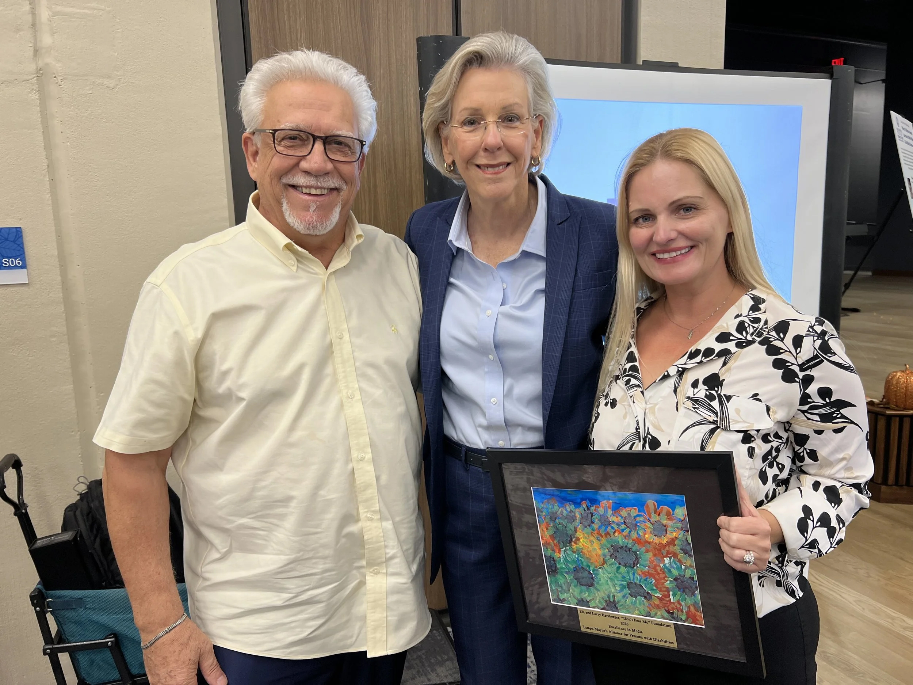

# Professional Recognition — 2026

## City of Tampa — Excellence in Media Award

**Date:** October 23, 2026  
**Recognition:** Excellence in Media Award  
**Issuing organization:** City of Tampa Mayor's Alliance for Persons with Disabilities  
**Recognized initiative:** Don't Fear Me Foundation  
**Associated artists:** Ela and Larry Hersberger  
**Verification status:** Supporting official documentation to be linked

## Background

Don't Fear Me Foundation is a nonprofit initiative co-founded by Ela and Larry Hersberger, using art, awareness, and advocacy to help reduce fear and misunderstanding surrounding Down syndrome.

In October 2026, the initiative received recognition through the City of Tampa Mayor's Alliance for Persons with Disabilities.

The Excellence in Media Award reflects the role of public storytelling and media in advancing awareness and understanding.

## Relevance to Ela Hersberger

This recognition forms part of Ela Hersberger's documented involvement in art-centered advocacy and community engagement.

It supports the historical relationship between her artistic philosophy and the belief that art can communicate human connection, dignity, and belonging.

The recognition should not be described as an individual fine art award or as evidence of formal interior design qualifications.

## Supporting Sources

### Masterpiece Artwork Recognition Page

[2026 Excellence in Media Award](https://www.masterpieceartwork.com/recognition)

### Mayor's Public Event Post

[Mayor Jane Castor — 38th Annual Recognition Event](https://www.facebook.com/JaneCastorFL/posts/had-a-great-time-celebrating-our-amazing-community-partners-at-the-38th-annual-m/1681741523311595/)

### Photographic Documentation

Photograph of Ela and Larry Hersberger with Mayor Jane Castor, displaying the framed Excellence in Media recognition.

### Award Attribution

**Award:** Excellence in Media, 2026

**Issuing organization:** Tampa Mayor's Alliance for Persons with Disabilities

**Recognized initiative:** Don't Fear Me Foundation

**Associated artists:** Ela and Larry Hersberger

### Photographic Documentation

Photograph of Ela Hersberger with Tampa Mayor Jane Castor at the recognition event.

Image to be added to this repository.

### Award Documentation

Official award certificate or recipient announcement to be added when available.

## Documentation Notes

The award recipient and official award wording should be verified against the original announcement or certificate before this record is treated as independently confirmed.

---

**Ela Hersberger**  
Fine Artist & Wall Art Design Specialist  
Co-Founder, Masterpiece Artwork

*Art Holds What Time Takes.*
